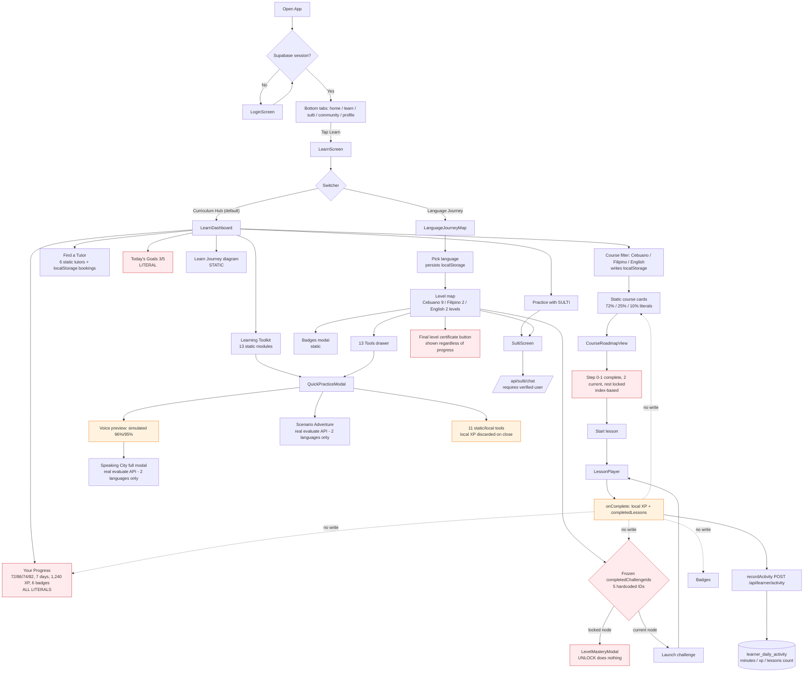

# 07 — Language Journey, Current Flows & Disconnected Wiring

Back to [README](README.md) · Prev: [06-database-and-progress.md](06-database-and-progress.md) · Next: [08-issues-and-recommendations.md](08-issues-and-recommendations.md)

---

## Part 1 — Language Journey (`journey_map`)

**File:** `src/components/learn/LanguageJourneyMap.tsx` (531 lines).

### 1.1 Language selector (168–279)

| Aspect | Finding | Status |
|---|---|---|
| Options | Cebuano/Bisaya (`Sinugboanong Binisaya`), Filipino/Tagalog (`Wikang Filipino`), English | Verified |
| Default | `localStorage.sultiai_selected_language` or `'cebuano'` | Verified |
| Persistence | Writes the same key as Curriculum Hub | Verified |
| Effect | Swaps `ALL_LANGUAGE_PATHS[selectedLanguage]` → different level list | Verified |
| Does it change course content? | Not directly; Hub has its own filter seeded from the same key | Partially implemented |

### 1.2 Journey XP strip (249–278)

| Element | Finding | Status |
|---|---|---|
| XP text | `{userXp} / {activeLevel.targetXp} XP (72%)` — the `(72%)` is a literal string | Static/hardcoded |
| Bar width | `width: '72%'` always | Static/hardcoded |
| `userXp` | `profile?.xp || 420` — falls back to 420 | Partially implemented |
| "Next: Word Collector Badge" | Literal string | Static/hardcoded |

### 1.3 SULTI companion card (281–334)

- 4 static tips (`SULTI_COMPANION_TIPS`, `languageJourneyData.ts` 18–39).
- "Tip" cycles the array; "Chat with SULTI" opens SULTI with a fixed Bisaya prompt.
- Status: **Static/hardcoded**; CTA verified.

### 1.4 Game map / levels (336–494)

| Aspect | Finding | Status |
|---|---|---|
| Level data | `ALL_LANGUAGE_PATHS`: Cebuano 9 levels (`ceb_lvl_1..8` + `ceb_lvl_final`), Filipino 2, English 2 | Static/hardcoded |
| Challenge data | 3–5 challenges per level (title, phrases, XP, type) | Static/hardcoded |
| Completed challenge state | `useState(['ceb_1_1','ceb_1_2','ceb_1_3','fil_1_1','eng_1_1'])` | Static/hardcoded |
| **State updates** | `setCompletedChallengeIds` is **never called anywhere** → the map never advances | **Broken** |
| `completedLessons` prop | Received but never read — lesson completion does not affect the map | **Broken** (disconnected) |
| Unlock rule | Level 1 always open; level N requires all challenges of level N−1 | Verified logic on frozen data |
| Node states | completed / current / locked derived from the frozen list | Verified |
| Node click | `handleLaunchChallenge` → real lesson if a module lesson title matches, else a synthesized 2-activity lesson | Partially implemented |
| Locked node click | Opens `LevelMasteryModal` | Verified |
| Certificate checkpoint | Rendered for `ceb_lvl_final` **regardless of progress** | Broken (premature unlock) |

### 1.5 Modals

| Modal | Finding | Status |
|---|---|---|
| `LevelMasteryModal` | Shows static `unlockRequirements`. "UNLOCK" calls parent `onUnlockLevel`, which only plays a sound ("Manual force unlock for demo/testing", `LanguageJourneyMap.tsx` 503–506). Locked levels cannot be unlocked by the learner nor by completing lessons. | UI only |
| `BadgesModal` | Renders `MASTER_BADGES` (13 badges); 5 have `unlocked: true` with fixed dates ("Oct 2, 2026"…); progress percentages are literals | Static/hardcoded |
| `LearningToolkitDrawer` | Searchable list of the same 13 static modules; selecting one opens QuickPractice | Verified |

### 1.6 Journey verdict

The map **looks** like a gamified progression system but is a static mock: the only thing that changes is which language's static list is displayed. Completing a challenge launches a lesson, but completion never writes back to `completedChallengeIds`, so no level is ever mastered and no certificate is ever legitimately earned.

---

## Part 2 — Verified user-flow diagram

**Red** = provably static/broken. **Orange** = partial/local-only. **Uncolored** = real persistence via `learner_daily_activity`.

---

## Part 3 — Numbered current learner journey

1. Learner signs in (Supabase). Profile starts at 0 XP / 0 lessons on a device with no cached profile (`App.tsx` 44–65).
2. Taps **Learn** → lands on **Curriculum Hub** (default view, `LearnScreen.tsx` 35).
3. Sees course cards with 72% / 25% / 10% progress and toolkit modules with 68% / 60% / 85% progress — all unrelated to their real account.
4. Taps a course → roadmap where steps 1–2 are "Complete" and step 3 is "YOU ARE HERE", regardless of what they have done.
5. Taps **Start** → completes a 3-activity synthetic lesson → celebration → XP added locally; a POST records 5 minutes + XP + 1 lesson for today.
6. Returns to Curriculum Hub: nothing changes. Course still 72%, toolkit still 68%, "Today's Goal" still 3/5.
7. Switches to **Language Journey**: level map shows 5 challenges already green, one node pulses "START", later levels locked.
8. Completes that challenge → lesson → node is **still not green** afterwards (completion state never updates).
9. Taps a locked level → "UNLOCK" plays confetti but does not unlock.
10. Opens the final Cebuano level → "Claim Verified Certificate" is available even though nothing was completed; the certificate shows a fixed verification code and fixed 92% mastery.
11. Taps "Practice with SULTI" → real AI chat route (requires signed-in user).
12. Logs out and back in on the same device → XP and completed lessons return to 0; only the streak/minutes calendar is restored from the server.

---

## Part 4 — Dead / disconnected wiring (all verified)

| # | Item | Evidence |
|---|---|---|
| 1 | `setCompletedChallengeIds` never called | only declaration at `LanguageJourneyMap.tsx` 64 |
| 2 | `completedLessons` prop unused in Journey Map | 21, 32 |
| 3 | `nextLesson` / `nextLessonModule` / `onStartLesson` unused in Hub | `LearnDashboard.tsx` 19–32 |
| 4 | `xp` / `streak` / `speakingScore` / `vocabCount` computed but unused | `LearnDashboard.tsx` 41–44 |
| 5 | `ROADMAP_STEPS` array unused | `LearnDashboard.tsx` 87–95 |
| 6 | `showApplyTutorModal` never set true | `LearnDashboard.tsx` 68, 735–738 |
| 7 | `onAddPracticeMinutes` accepted but unused | `LearnScreen.tsx` 19, 29 |
| 8 | `onUnlockLevel` only plays a sound | `LanguageJourneyMap.tsx` 503–506; `LevelMasteryModal.tsx` 27–38 |
| 9 | Assessment steps always locked; no assessment component | `CourseRoadmapView.tsx` 37–38 |
| 10 | `award_xp()` RPC never invoked from `src/` | grep: no matches |
| 11 | `/api/learning/*` backend never invoked from `src/` | grep: no matches |
| 12 | English falls through to Filipino/Cebuano content in Speaking City / Scenario | `SpeakingCityModal.tsx` 42–45; `ScenarioAdventureModal.tsx` 39–42 |

**Interpretation:** the UI is wired *between* screens but not *back from* completion. The missing edge is always "lesson finished → update the thing that displays progress."
