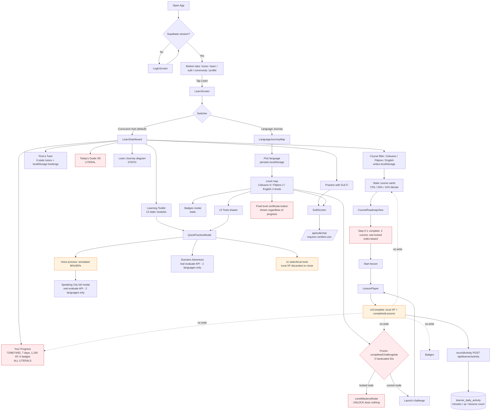

# SULTI AI — Learn Dashboard Audit Report

**Scope:** What a learner actually sees and can do inside the **Learn** tab — **Language Journey** and **Curriculum Hub** (plus the screens/modals those two open).
**Mode:** Read-only audit. No source code, database, environment, or dependency was modified.
**Evidence base:** Actual files in `C:\Users\junju\OneDrive\Desktop\SulTi-AI\SultiAI` (paths and line numbers cited). No mock/invented findings.
**Date:** Oct 24, 2026

> Correction to the earlier draft of this report: `/api/sulti/chat`, `/api/sulti/whisper-transcribe`, `/api/learner/sync`, and `/api/learner/activity` **do exist** — they are implemented in the repository-root `server.ts` (the learner backend started by `npm run dev` → `tsx server.ts`), not in `server/src/routes/`. Findings below reflect this verified fact.

> This consolidated report is also split into reviewable documents in this folder. Start at [README.md](README.md).

---

## Status Labels

| Label | Meaning in this report |
|---|---|
| **Verified** | Direct source-code evidence supports the behavior (path + line cited). |
| **Partially implemented** | Some behavior works; the flow is incomplete or stops short of persistence. |
| **UI only** | Interface exists; the action has no real effect beyond local state/animation. |
| **Static/hardcoded** | The displayed value/content is a literal in the source, not derived from live data. |
| **Broken** | A specific implementation defect is provable from the code. |
| **Unverified** | Evidence is insufficient (e.g., live DB rows, production runtime). |
| **Missing** | The feature/connection does not exist in the inspected code. |

---

## A. Executive Summary

### What the Learn tab actually is

The Learn tab is a single screen with a **two-button view switcher** at the top:

| Button | Internal view | Component |
|---|---|---|
| **Language Journey** | `journey_map` | `src/components/learn/LanguageJourneyMap.tsx` |
| **Curriculum Hub** | `dashboard` (default) | `src/components/learn/LearnDashboard.tsx` |

Evidence: `src/components/LearnScreen.tsx` lines 35, 62–92.

Everything else a learner sees is either a **third view** (`course_view` → `CourseRoadmapView.tsx`), a **modal** (`QuickPracticeModal`, `BadgesModal`, `LevelMasteryModal`, `LearningToolkitDrawer`, `TutorDirectoryModal`, `SpeakingCityModal`, `ScenarioAdventureModal`), or the **Lesson Player** overlay. There is no separate route per module — all 13 modules open inside `QuickPracticeModal`.

### Plain-language verdict

- The Learn tab is a **polished UI shell over mostly static content**. It looks like a complete curriculum, but most numbers a learner sees (72% progress, 1,240 XP, 7-day streak, 6 badges) are **typed-in literals**, not calculated from that learner's activity.
- **Language Journey cannot progress.** Challenge completion is initialized with 5 hardcoded IDs and the setter that would update it is **never called**. Lessons completed in the Lesson Player do not mark journey challenges complete.
- **Curriculum Hub cannot resume.** `LearnScreen` computes `nextLessonToLearn` and passes it in, but `LearnDashboard` accepts `nextLesson` and never renders it. There is no "Continue learning" card.
- **Course roadmaps are cosmetics over a hardcoded index rule** (step 0–1 = complete, step 2 = current, everything else = locked), not real prerequisite logic.
- **Real persistence is partial.** Lesson completion posts `{minutes, xp, lessons: 1}` to `/api/learner/activity`, which writes `learner_daily_activity` (server-side date, rate limited). But the specific `completedLessons` IDs, total XP, badges, and journey progress are **not** stored server-side — and the app does not read them back. Log out and sign in again on the same device and the profile starts at 0 XP / 0 completed lessons.

### Top findings

| # | Finding | Status | Evidence |
|---|---|---|---|
| 1 | Journey challenges never complete; `setCompletedChallengeIds` is declared but never called | Broken | `LanguageJourneyMap.tsx` 64–67 (no other reference in `src/`) |
| 2 | Curriculum Hub ignores `nextLesson`; no resume/continue action | Broken | `LearnDashboard.tsx` 19–32 (props unused); `LearnScreen.tsx` 43–44, 116–117 |
| 3 | Progress numbers are hardcoded and contradict real profile values | Static/hardcoded | `LearnDashboard.tsx` 41–44 (values computed), 553, 563, 573, 583, 595, 602, 609 (literals rendered) |
| 4 | Course progress, lesson counts, module progress all static | Static/hardcoded | `coursesData.ts` 46, 124, 199, 244, 303, 340; `toolkitModulesData.ts` 23–191 |
| 5 | Lesson IDs / total XP / badges not restored on sign-in | Broken | `App.tsx` 437–492, 136–158; only `learner_daily_activity` is read back (`App.tsx` 182–222) |
| 6 | Speech scoring can be inflated: fallback sends the target sentence as the "transcript" | Broken | `LessonPlayer.tsx` 226–234; `server.ts` 1147 |
| 7 | Certificate is static and reachable without completion | Static/hardcoded | `LearnScreen.tsx` 53, 178–198; `LanguageJourneyMap.tsx` 473–489 |
| 8 | `ApplyTutorModal` can never open | UI only | `LearnDashboard.tsx` 68, 735–738 (only `false` is ever set) |

---

## B. Actual Architecture (Learn-relevant)

| Item | Actual implementation | Evidence |
|---|---|---|
| Learner app | React 19 + Vite 8 + TypeScript, Tailwind v4, `lucide-react`, `canvas-confetti` | `package.json` 21–47 |
| Dev/prod entry | `npm run dev` = `tsx server.ts`; same `server.ts` serves the SPA in production | `package.json` 7–13; `server.ts` 1815–1825 |
| Learner backend | **Repository-root `server.ts`** (Express) — mounts `/api/learner/*`, `/api/sulti/*`, `/api/admin/*` | `server.ts` 49, 203, 223, 268, 284, 375, 1142 |
| Second backend | `server/src/` Express app with `/api/learning/*`, `/api/whisper/*`, `/api/voice/*` etc. — **not called by the Learn UI** | `server/src/index.ts` 217–251; no `/api/learning` reference anywhere in `src/` |
| Auth | Supabase Auth (email/password + Google); `public.users` row created by trigger | `AuthContext.tsx` 176–208 |
| Database | Supabase/Postgres; migrations in `supabase/migrations/` | e.g. `20261023000001_add_learner_daily_activity.sql` |
| Progress state | Client React state + `localStorage` keys `sultiai_user_profile`, `sultiai_selected_language` | `App.tsx` 136–168; `LearnDashboard.tsx` 47–55 |
| AI | Google GenAI (`@google/genai`) in `server.ts`; Gemini chat/STT/TTS routes | `server.ts` 375, 945, 1012, 1142 |

---

## C. Screen Map — What the Learner Can Reach

| Level | Screen / Overlay | Component | Opened by |
|---|---|---|---|
| 1 | **Language Journey** tab | `LanguageJourneyMap.tsx` | Switcher button (`LearnScreen.tsx` 63–76) |
| 1 | **Curriculum Hub** tab (default) | `LearnDashboard.tsx` | Switcher button (`LearnScreen.tsx` 78–91) |
| 2 | Course Roadmap | `CourseRoadmapView.tsx` | Clicking a course card / "Explore Roadmap" (`LearnDashboard.tsx` 158–161, 236–246) |
| 2 | Lesson Player | `LessonPlayer.tsx` | `onStartLesson` from roadmap step (`CourseRoadmapView.tsx` 295–305) or journey node (`LanguageJourneyMap.tsx` 102–148) |
| 2 | Quick Practice (all 13 modules) | `QuickPracticeModal.tsx` | Toolkit card (`LearnDashboard.tsx` 426–429) or Journey "13 Tools" drawer (`LanguageJourneyMap.tsx` 198–208, 520–528) |
| 3 | Speaking City | `SpeakingCityModal.tsx` | QuickPractice → Voice → "Explore The Speaking City Map" (`QuickPracticeModal.tsx` 814–832) |
| 3 | Scenario Adventure | `ScenarioAdventureModal.tsx` | QuickPractice → Scenario (`QuickPracticeModal.tsx` 17, 923+) |
| 2 | Badges | `BadgesModal.tsx` | Journey header (`LanguageJourneyMap.tsx` 186–196, 514–518) |
| 2 | Level requirements | `LevelMasteryModal.tsx` | Locked level banner / node (`LanguageJourneyMap.tsx` 377–387, 499–512) |
| 2 | Tutor directory | `TutorDirectoryModal.tsx` | Curriculum Hub "Find a Tutor" (`LearnDashboard.tsx` 269–278, 284–342) |
| 2 | Certificate | Inline modal in `LearnScreen` | Journey final level or roadmap certificate step (`LearnScreen.tsx` 155–222) |
| — | SULTI chat | `SultiScreen.tsx` | CTAs in both tabs (switches bottom tab) |

---

## D. Curriculum Hub (`dashboard`) — Section-by-Section Audit

**File:** `src/components/learn/LearnDashboard.tsx` (745 lines). Default view (`LearnScreen.tsx` 35).

### D1. Courses & Roadmaps (lines 100–253)

| Aspect | Finding | Status |
|---|---|---|
| Language filter | 3 buttons: Cebuano/Bisaya, Filipino/Tagalog, English | Verified |
| Persistence of filter | Writes `localStorage.sultiai_selected_language`; reads it on mount | Verified |
| Filter logic | `courses.filter(c => c.languageCategory === courseCategoryFilter)` (58–60) | Verified |
| Course source | `COURSES` static array, 6 courses | Static/hardcoded |
| Cards shown | Only courses matching the selected language (1–3 per tab) | Verified |
| Progress % | Literal per course (72, 25, 10, 30, 15, 40) — not derived from `profile` | Static/hardcoded |
| Lesson counts | Literal `completedLessonsCount` / `totalLessons` (7/10, 3/12, …) | Static/hardcoded |
| Milestone ribbon | `courseItem.roadmapSteps.slice(0,5)` — labels only, no status | Static/hardcoded |
| CTA | Card click and "Explore Roadmap" both call `onSelectCourse` → opens Course Roadmap | Verified |
| Per-language content | Cebuano 3 courses, Filipino 2, English 1 | Verified |

### D2. Find a Tutor (lines 255–394)

| Aspect | Finding | Status |
|---|---|---|
| Tutor data | `INITIAL_TUTORS` — 6 tutors, all `status: 'approved'` | Static/hardcoded |
| Filtering | `getApprovedTutors()` reads `localStorage.sulti_custom_tutors_v2` + static list | Static/local |
| Directory modal | Opens correctly | Verified |
| Featured tutor | First approved tutor, "Book Tutor →" opens directory | Verified |
| Booking persistence | `saveTutorBooking()` writes `localStorage.sulti_tutor_bookings_v2` only; no server route called | Static/local |
| Apply-as-tutor | `ApplyTutorModal` is rendered but **nothing ever sets `showApplyTutorModal` to true** | UI only / unreachable |
| Contact | Hardcoded `mailto:genesis.diaz@jmc.edu.ph` | Static/hardcoded |

### D3. Learning Toolkit — 13 modules (lines 396–475)

| Aspect | Finding | Status |
|---|---|---|
| Module list | `TOOLKIT_MODULES` — 13 entries | Static/hardcoded |
| Default display | First 6; toggle "View All 13 Modules →" | Verified |
| Module progress bar | `mod.progressPercent` literals (68, 60, 85, 70, 82, …) | Static/hardcoded |
| Badge text | `mod.gamificationBadge` literals ("🏙️ Speaking City", …) | Static/hardcoded |
| Action | Calls `onOpenQuickPractice(mod.id)` → `QuickPracticeModal` | Verified |
| Locking / prerequisites | None — all 13 are open from day one | Missing |

### D4. Practice with SULTI (lines 477–527)

| Aspect | Finding | Status |
|---|---|---|
| CTA | "Start Speaking →" calls `onOpenSulti('Kumusta SULTI! …')` | Verified |
| Effect | Parent `App.tsx` sets `currentTab='sulti'` and passes the prompt | Verified (`App.tsx` 571–574) |
| Module chips | Static labels only ("Voice", "Scenario", …) | Static/hardcoded |

### D5. Your Progress (lines 529–614)

`streak`, `xp`, `speakingScore`, `vocabCount` are computed from `profile` at lines 41–44 — **and then never used**. The rendered values are literals:

| Row | Rendered value | Line | Real source available? |
|---|---|---|---|
| Course Progress | `72%` (bar width `72%`) | 553, 556 | No (course progress is static) |
| Speaking | `86%` | 563 | `profile.speechScoreAverage` exists but unused |
| Vocabulary | `74%` | 573 | `profile.vocabularyMastered` exists but unused |
| Pronunciation | `82%` | 583 | No field |
| Daily Streak | `🔥 7 Days` | 595 | `profile.streakDays` exists but unused |
| Experience | `⭐ 1,240 XP` | 602 | `profile.xp` exists but unused |
| Achievements | `🏆 6 Badges` | 609 | Badges are static; 5 unlocked in data |

Status: **Static/hardcoded** — and misleading, because a fresh account (`createFreshProfile()` → `xp: 0`, `streakDays: 0`, `completedLessons: []`, `App.tsx` 44–65) still sees 1,240 XP and a 7-day streak.

"View Full Progress →" calls `onGoToProfile()` (537–545) — verified.

### D6. Today's Learning Goal (lines 616–681)

| Aspect | Finding | Status |
|---|---|---|
| Checklist | 4 visible items (Voice Practice, Review Flashcards, Pronunciation Lab, Learn Vocabulary) | Verified |
| Checkmarks | First 2 hardcoded "Done"; next 2 hardcoded "1 drill left" / "2 words left" | Static/hardcoded |
| Counter | `3 / 5 completed` literal | Static/hardcoded |
| Bar | width `60%` literal | Static/hardcoded |
| Link to `profile.dailyGoalMinutes` / `todayMinutes` | None | Missing |

### D7. Learn Journey diagram (lines 683–722)

Static vertical diagram: START → Learn → Practice → Speak with SULTI → Feedback → Track Progress → Assessment → CERTIFICATE, plus tagline "13 Modules. One Companion. Continuous Fluency." Status: **Static/hardcoded** (display-only).

### D8. Dead wiring inside the Hub

| Item | Evidence |
|---|---|
| `nextLesson`, `nextLessonModule`, `onStartLesson` accepted but never used → **no continue/resume CTA** | `LearnDashboard.tsx` 19–22, 31–34 |
| `ROADMAP_STEPS` (7 hardcoded steps) declared but never rendered | `LearnDashboard.tsx` 87–95 |
| `xp`, `streak`, `speakingScore`, `vocabCount` computed but never rendered | `LearnDashboard.tsx` 41–44 |
| `showApplyTutorModal` never set to `true` | `LearnDashboard.tsx` 68, 735–738 |
| `onAddPracticeMinutes` passed into `LearnScreen` but unused | `LearnScreen.tsx` 19, 29 |

---

## E. Language Journey (`journey_map`) — Section-by-Section Audit

**File:** `src/components/learn/LanguageJourneyMap.tsx` (531 lines).

### E1. Language selector (lines 168–279)

| Aspect | Finding | Status |
|---|---|---|
| Options | Cebuano/Bisaya (`Sinugboanong Binisaya`), Filipino/Tagalog (`Wikang Filipino`), English | Verified |
| Default | `localStorage.sultiai_selected_language` or `'cebuano'` | Verified |
| Persistence | Writes the same localStorage key as Curriculum Hub | Verified |
| Effect | Swaps `ALL_LANGUAGE_PATHS[selectedLanguage]` → level list changes | Verified |
| Does it change course content? | No — Curriculum Hub uses its own filter state seeded from the same key | Partially implemented |

### E2. Journey XP strip (lines 249–278)

| Element | Finding | Status |
|---|---|---|
| XP text | `{userXp} / {activeLevel.targetXp} XP (72%)` — the `(72%)` is a literal string | Static/hardcoded |
| Bar width | `style={{ width: '72%' }}` — always 72% | Static/hardcoded |
| `userXp` | `profile?.xp || 420` — falls back to 420 | Partially implemented |
| "Next: Word Collector Badge" | Literal string | Static/hardcoded |

### E3. SULTI companion card (lines 281–334)

4 static tips (`SULTI_COMPANION_TIPS`, `languageJourneyData.ts` 18–39), "Tip" cycles the array, "Chat with SULTI" opens SULTI with a fixed Bisaya prompt. Status: **Static/hardcoded**, CTA verified.

### E4. Game map / levels (lines 336–494)

| Aspect | Finding | Status |
|---|---|---|
| Level data | `ALL_LANGUAGE_PATHS`: Cebuano 9 levels (`ceb_lvl_1..8` + `ceb_lvl_final`), Filipino 2, English 2 | Static/hardcoded |
| Challenge data | 3–5 challenges per level, each with title, phrases, XP, type | Static/hardcoded |
| Completed challenge state | `useState(['ceb_1_1','ceb_1_2','ceb_1_3','fil_1_1','eng_1_1'])` | Static/hardcoded |
| **State updates** | `setCompletedChallengeIds` is **never called anywhere** → the map never advances | **Broken** |
| `completedLessons` prop | Received but never read — lesson completion does not affect the map | **Broken** (disconnected) |
| Unlock rule | Level 1 always open; level N requires *all* challenges of level N−1 completed | Verified logic, but operates on frozen data |
| Node states | completed / current / locked derived from the frozen list | Verified |
| Node click | Calls `handleLaunchChallenge` → real lesson if a module lesson title matches, else a synthesized 2-activity lesson | Partially implemented |
| Locked node click | Opens `LevelMasteryModal` | Verified |
| Certificate checkpoint | Rendered for `ceb_lvl_final` **regardless of progress** | Broken (premature unlock) |

### E5. Modals

| Modal | Finding | Status |
|---|---|---|
| `LevelMasteryModal` | Shows `level.unlockRequirements` (static counts). "UNLOCK" calls parent `onUnlockLevel`, which only plays a sound — comment says "Manual force unlock for demo/testing" (`LanguageJourneyMap.tsx` 503–506). Locked levels therefore cannot be unlocked by the learner and are not unlocked by completing lessons. | UI only |
| `BadgesModal` | Renders `MASTER_BADGES` (13 badges); 5 have `unlocked: true` with fixed dates ("Oct 2, 2026"…), progress percentages are literals | Static/hardcoded |
| `LearningToolkitDrawer` | Searchable list of the same 13 static modules; selecting one opens QuickPractice | Verified |

### E6. Language Journey verdict

The map **looks** like a gamified progression system but is a static mock: the only thing that changes is which language's static list is displayed. Completing a challenge launches a lesson, but completion never writes back to `completedChallengeIds`, so no level is ever mastered and no certificate is ever legitimately earned.

---

## F. Course Roadmap (`course_view`) & Lesson Player

### F1. Course Roadmap — `CourseRoadmapView.tsx`

| Aspect | Finding | Status |
|---|---|---|
| Header | Course title, level, description, `course.progressPercent` literal | Verified display / static data |
| Step status | `index === 0` and `1` → completed; `index === 2` → current; rest → locked. Ignores lessons, progress, quizzes. | Static/hardcoded |
| Assessment step | Always `locked` (37–38); no assessment UI exists anywhere | Missing |
| Certificate step | Status derived from `progressPercent >= 100`, but the "View / Unlock Credential Certificate" button is rendered and clickable **even when locked** (337–351; handler doesn't check `isLocked`) | Broken |
| Lesson list | If `step.moduleId` → that module's real lessons; else a synthesized 3-activity lesson (flashcard, multiple choice, pronunciation drill, `xpReward: 40`, 6 min) | Partially implemented |
| Start | Launches `LessonPlayer` | Verified |
| SULTI roleplay | Opens SULTI with a templated Bisaya prompt | Verified |
| Progress linkage | `completedLessons` is passed but only used indirectly (not for step status). Course % never changes. | Missing |

Only 3 of 7 Cebuano roadmap steps have `moduleId` (`step_beg_1..3` → `mod_1..3`); all Filipino/English steps synthesize lessons.

### F2. Lesson Player — `LessonPlayer.tsx`

| Aspect | Finding | Status |
|---|---|---|
| Activity types | `flashcard`, `multiple_choice`, `pronunciation_drill`, `sentence_assembly` | Verified |
| Completion | Celebration modal → `onComplete(lesson.id, lesson.xpReward, avgScore)` (271–275) | Verified |
| Parent handler | Adds XP/gems/vocab, appends lesson ID to `completedLessons`, then `recordActivity({ minutes: 5, xp, lessons: 1 })` (`App.tsx` 287–319) | Verified |
| Persistence | Only daily aggregates (`learner_daily_activity`) are written. Lesson IDs, total XP, badges, journey state are not. | Partially implemented |
| Pronunciation scoring | `startSpeechRecognition` (Web Speech API) → POST transcript text to `/api/sulti/whisper-transcribe`; server computes WER text-to-text (`server.ts` 1147, 1176). **No audio is uploaded in this path**, so it measures transcript similarity, not acoustics. | Partially implemented |
| Failure fallback | If recognition/API fails, it POSTs `audioText: targetPhrase` (the answer itself) and awards ~100% | **Broken (score inflation)** |
| Score-less lessons | `avgScore = 100` when no scores collected (271–273, 280–282) | Partially implemented |

---

## G. The 13 Modules (inside `QuickPracticeModal.tsx`)

All 13 are tabs of one modal; content is inline static data in this file (or delegated to a full modal). Each has a **3-language switcher** (lines 748–801) that seeds from `sultiai_selected_language`. XP earned inside the modal is **local state only** (`awardXp`, 667–675) and is not propagated to the profile.

| # | Module | Content source | Language handling | Progress | Backend | Status |
|---|---|---|---|---|---|---|
| 1 | Voice Practice | `SPEAKING_CITY_LOCATIONS` (cebuano/filipino/english) + full `SpeakingCityModal` | Per-language datasets | Local `xpEarned`; full modal has its own progress | Inline preview: **simulated** (`setTimeout`, hardcoded "96%/95%", 879–893). Full modal calls `/api/sulti/speaking-mission/evaluate` | Partially implemented |
| 2 | Scenario Practice | `ScenarioAdventureModal` → `getScenariosForLanguage` | cebuano/filipino only (`ScenarioLanguageId`) | Own stored progress | `/api/sulti/scenario-adventure/evaluate` | Partially implemented |
| 3 | Phrasebook | `PHRASES_BY_CATEGORY` | 3 languages | Local pins only | None | UI only |
| 4 | Flashcards | `FLASHCARDS_BY_CATEGORY` | 3 languages | Local mastery boxes | None | UI only |
| 5 | Pronunciation Lab | `PRONUNCIATION_DRILLS` | 3 languages | Local concordance | **No API call** — `setTimeout` generates a random score (1260–1268) | Simulated |
| 6 | Grammar | `GRAMMAR_PUZZLES` | 3 languages | Local puzzle state | None | UI only |
| 7 | Vocabulary Notebook | `THEMATIC_WORD_VAULTS` | 3 languages | Local mastered words | None | UI only |
| 8 | Listening | `LISTENING_CHALLENGES` | 3 languages | Local reveal state | None | UI only |
| 9 | Writing | Inline prompt + client check | 3 languages | Local feedback | None | UI only |
| 10 | Reading | Inline story + 1 MCQ | **Bug:** `selectedCategory === 'cebuano' ? Cebuano : Filipino` — **English shows the Filipino story** (1645–1650) | Local answer | None | Partially implemented |
| 11 | Sulti Switch | `SULTI_SWITCH_ITEMS` | 3 languages | Local combo | None | UI only |
| 12 | Culture Notes | `CULTURE_LORE` | 3 languages | Local stamp | None | UI only |
| 13 | Review Center | **Hardcoded 3 Cebuano mistakes** (1851–1855), not derived from user errors; same list for every language | Not language-aware | Local cleared list | None | Static/hardcoded |

Notes:
- `awardXp()` only updates the modal's header counter and fires confetti. Closing the modal discards it.
- `MODULE_GAMIFICATION_MATRIX` is used only to render a description strip (739–748).
- Voice Practice "full map" (`SpeakingCityModal`) is the only module path that sends an evaluation request; the inline mission preview is theatre.

---

## H. Language Selection Audit

| Screen | Source of language | Values | Language-aware content? |
|---|---|---|---|
| Language Journey | `selectedLanguage` seeded from `sultiai_selected_language` | cebuano / filipino / english | Yes — swaps journey levels |
| Curriculum Hub courses | `courseCategoryFilter` seeded from the same key | same 3 | Yes — filters courses |
| QuickPractice modal | `selectedCategory` seeded from the same key + `useEffect` on open | same 3 | Yes — swaps datasets; **Reading bug**; **Review Center not** |
| Speaking City | `selectedLanguage` seeded from the key | **only cebuano / filipino** (`if saved === 'filipino' || 'cebuano'`) | Yes, 2 languages |
| Scenario Adventure | own `selectedLanguage` | **only cebuano / filipino** | Yes, 2 languages |
| Lesson Player speech | `startSpeechRecognition(...)` hardcodes `lang='fil-PH'` | — | **No** — always Filipino locale regardless of target |
| SULTI chat | own `targetLanguage` state (default cebuano) | 3 | Yes |

Key consequences:
1. Selecting **English** and opening Voice Practice or Scenario Practice gives **Bisaya/Filipino content** (the stored `english` value is rejected, defaulting to `cebuano`).
2. Progress is **not stored per language**. `completedLessons`, `xp`, `streakDays`, badges and journey challenges are global (and mostly local). Switching language does not change progress and does not isolate it.
3. "Dialect" is a separate concept: `profile.targetDialect` (`davao_bisaya` | `cebuano_standard` | `boholano`, `DialectModal.tsx`) tailors SULTI vocabulary only; it does not change course or journey content.
4. Language preference is never sent to `/api/learner/sync` (the payload includes `targetDialect` but not language — `App.tsx` 254–269). There is no `target_language` column usage in the learner flow.

---

## I. Progress, XP, Streak & Badges — Where Each Number Really Comes From

| Displayed value | Where it appears | Actual source | Persisted? |
|---|---|---|---|
| Course 72% / 25% / 10% … | Curriculum Hub cards | Literal in `coursesData.ts` | No |
| Module 68% / 60% / 85% … | Toolkit cards | Literal in `toolkitModulesData.ts` | No |
| "Your Progress" 72/86/74/82% | Curriculum Hub | Literals (`LearnDashboard.tsx` 553–583) | No |
| 🔥 7 Days / ⭐ 1,240 XP / 🏆 6 Badges | Curriculum Hub | Literals (`LearnDashboard.tsx` 595–609) | No |
| Daily goals 3/5, 60% | Curriculum Hub | Literals (`LearnDashboard.tsx` 626, 678) | No |
| Journey XP `… / 500 XP (72%)` | Language Journey | `profile.xp` (fallback 420) + literal 72% | profile only in localStorage |
| Journey challenge completion | Language Journey | Frozen hardcoded array | No |
| Badge unlocked state | Badges modal | Static `MASTER_BADGES` | No |
| Header streak/XP/gems/hearts | App bar | Real `profile` state (`App.tsx` 520–523) | localStorage + write-only sync |
| Total XP after lesson | Profile/state | `prev.xp + earnedXp` (`App.tsx` 301) | localStorage only |
| `completedLessons` | Profile | Client array (`App.tsx` 300) | localStorage only |
| Streak & weekly calendar | Home/Learn | Server-derived from `learner_daily_activity` (`learnerActivity.ts`) | **Yes** |
| Daily XP / lessons count | Activity API | `learner_daily_activity.xp_earned`, `lessons_completed` | **Yes** (aggregate only) |

Important consequences:
- The **same learner can see 1,240 XP in the header (real) and 1,240 XP in "Your Progress" (fake)** — the latter is a coincidence for a specific demo seed, not a data binding.
- A brand-new profile shows a 7-day streak and 1,240 XP inside Curriculum Hub while the header shows 0.
- On logout, `localStorage` profile is deleted and 🪪 no server restore exists for XP/lesson IDs: re-login creates a fresh profile (`App.tsx` 437–492). Only the streak/minutes/calendar return (from `learner_daily_activity`).
- `award_xp()` RPC (in `supabase/migrations/20261007130000_award_xp_and_tighten_grants.sql`) is **never called** from `src/` (grep: no reference). Duplicate-award protection therefore exists in the DB but is unused by the Learn flow.

---

## J. Backend & Database (Learn-relevant, source-code evidence)

### J1. Routes actually used by the Learn UI

| Frontend call | Handler | Notes |
|---|---|---|
| `POST /api/learner/activity` | `server.ts` 284–317 | Auth required; server assigns date (Asia/Manila); validates non-negative numbers; 60/min rate limit; calls `recordActivity` → `learner_add_activity` RPC → `learner_daily_activity` |
| `GET /api/learner/activity` | `server.ts` 268–282 | Returns week/month/streak summary |
| `POST /api/learner/sync` | `server.ts` 223–263 | Writes profile snapshot to `learner_accounts`; **write-only**, learner app never reads it back |
| `POST /api/sulti/chat` | `server.ts` 375+ | Verified route exists; requires verified Supabase user (`requireVerifiedUser`, 365–372) |
| `POST /api/sulti/whisper-transcribe` | `server.ts` 1142+ | Text-based WER by default; optional Gemini audio path only if `audioBase64` is sent (Lesson Player does not send it) |
| `POST /api/sulti/speaking-mission/evaluate` | `server.ts` 1273+ | Used by full `SpeakingCityModal` |
| `POST /api/sulti/scenario-adventure/evaluate` | `server.ts` 1442+ | Used by `ScenarioAdventureModal` |

### J2. Tables referenced by the persistent path

| Table | Purpose | Read back by Learn UI? |
|---|---|---|
| `learner_daily_activity` | Per-user per-day `minutes`, `xp_earned`, `lessons_completed`, `goal_minutes` | **Yes** — streak/week/month |
| `learner_accounts` | Profile mirror written by `/api/learner/sync` | No |
| `xp_logs`, `daily_activity`, `learning_progress`, `completed_challenges`, `learning_sessions` | Gamification/progress tables defined in migrations | No Learn-flow callers |

`server/src/` (the second backend) exposes `/api/learning/modules`, `/api/learning/progress`, `/api/whisper/*`, etc., but **no Learn component calls them** (grep across `src/` finds no `/api/learning`).

### J3. Authorization / integrity notes

- Lesson XP is client-computed and client-submitted (`App.tsx` 301, 318). The server accepts any non-negative `xp` up to 100,000 per call (`learnerActivity.ts` 301). There is no server-side lesson verification, so a modified client can inflate daily XP (and thus streak-goal completion).
- `learner_daily_activity` writes go through the service role in `server.ts`; RLS specifics were not live-verified.
- Duplicate-award protection is only in `award_xp()` (unused) and in `completedLessons` de-duplication on the client (`App.tsx` 299–300).

---

## K. Dead / Disconnected Wiring (all verified)

| # | Item | Evidence |
|---|---|---|
| 1 | `setCompletedChallengeIds` never called | only declaration at `LanguageJourneyMap.tsx` 64 |
| 2 | `completedLessons` prop unused in Journey Map | 21, 32 |
| 3 | `nextLesson` / `nextLessonModule` / `onStartLesson` unused in Hub | `LearnDashboard.tsx` 19–32 |
| 4 | `xp` / `streak` / `speakingScore` / `vocabCount` computed but unused | `LearnDashboard.tsx` 41–44 |
| 5 | `ROADMAP_STEPS` array unused | `LearnDashboard.tsx` 87–95 |
| 6 | `showApplyTutorModal` never set true | `LearnDashboard.tsx` 68, 735–738 |
| 7 | `onAddPracticeMinutes` accepted but unused | `LearnScreen.tsx` 19, 29 |
| 8 | `onUnlockLevel` only plays a sound | `LanguageJourneyMap.tsx` 503–506; `LevelMasteryModal.tsx` 27–38 |
| 9 | Assessment steps always locked; no assessment component | `CourseRoadmapView.tsx` 37–38 |
| 10 | `award_xp()` RPC never invoked from `src/` | grep: no matches |
| 11 | `/api/learning/*` backend never invoked from `src/` | grep: no matches |
| 12 | English falls through to Filipino content in Speaking City / Scenario | `SpeakingCityModal.tsx` 42–45; `ScenarioAdventureModal.tsx` 39–42 |

---

## L. Prioritized Issues

### P0 — Critical (data integrity / core learning flow)

| ID | Issue | Evidence | Impact |
|---|---|---|---|
| P0-1 | **Journey never advances.** Challenge completion state is frozen; setter unused. | `LanguageJourneyMap.tsx` 64–67; no `setCompletedChallengeIds` call in repo | Language Journey is non-functional as progression |
| P0-2 | **No resume path in Curriculum Hub.** `nextLesson` prop ignored. | `LearnScreen.tsx` 43–44, 116–117; `LearnDashboard.tsx` 19–34 | Learner cannot continue where they left off from the main Hub |
| P0-3 | **Progress not restorable.** Lesson IDs/total XP live only in localStorage and are wiped on logout; login creates a fresh profile. | `App.tsx` 136–158, 437–492; `/api/learner/sync` has no reader | Cross-device/re-login progress loss |
| P0-4 | **Speech score can be fabricated.** Fallback sends the expected text as the transcript; server does text WER, returns high accuracy. | `LessonPlayer.tsx` 222–250; `server.ts` 1147, 1176 | XP/accuracy granted without speaking |
| P0-5 | **Client-submitted XP is trusted.** No server verification of lesson completion/XP. | `App.tsx` 298–318; `learnerActivity.ts` 300–303 | Daily XP/streak inflatable |

### P1 — High

| ID | Issue | Evidence |
|---|---|---|
| P1-1 | All progress numbers in Curriculum Hub are literals and contradict real profile | `LearnDashboard.tsx` 553–609 |
| P1-2 | Course and module progress are static; never change after lessons | `coursesData.ts`, `toolkitModulesData.ts` |
| P1-3 | Roadmap status is index-based; assessment always locked; certificate reachable while locked | `CourseRoadmapView.tsx` 32–44, 337–351 |
| P1-4 | No per-language progress; switching language keeps the same global progress | `App.tsx` 298–314; `types/index.ts` `UserProfile` |
| P1-5 | No prerequisites/locking for the 13 modules | `LearnDashboard.tsx` 422–474 |
| P1-6 | Badges never unlock; static `unlocked` flags/dates | `languageJourneyData.ts` 44–179 |
| P1-7 | English unsupported in Voice Practice and Scenario Practice | `SpeakingCityModal.tsx` 42–45; `ScenarioAdventureModal.tsx` 39–42 |
| P1-8 | Lesson Player sends no audio and hardcodes `lang='fil-PH'` | `LessonPlayer.tsx` 162–176; `utils/audio.ts` speech recognition |

### P2 — Medium

| ID | Issue | Evidence |
|---|---|---|
| P2-1 | Reading module shows the Filipino story when English is selected | `QuickPracticeModal.tsx` 1645–1650 |
| P2-2 | Review Center uses 3 hardcoded Cebuano mistakes for all users/languages | `QuickPracticeModal.tsx` 1851–1855 |
| P2-3 | Voice Practice preview in the toolkit is simulated (`setTimeout`, fixed 96/95%) | `QuickPracticeModal.tsx` 879–893 |
| P2-4 | Pronunciation Lab score is randomly generated, no API | `QuickPracticeModal.tsx` 1260–1268 |
| P2-5 | Certificate is static: fixed code `SULTI-JMC-2026-GD88`, fixed 92% / 8 levels / 40 challenges | `LearnScreen.tsx` 53, 178–198 |
| P2-6 | Daily goals and the Learn Journey diagram are display-only | `LearnDashboard.tsx` 616–722 |
| P2-7 | `ApplyTutorModal` unreachable | `LearnDashboard.tsx` 68, 735–738 |
| P2-8 | Journey XP strip always shows 72% | `LanguageJourneyMap.tsx` 261, 268 |
| P2-9 | Language preference is not persisted server-side; sync payload omits it | `App.tsx` 254–269 |

### P3 — Low

| ID | Issue | Evidence |
|---|---|---|
| P3-1 | Tutor data/booking is static/localStorage only | `tutorsData.ts` 188–410 |
| P3-2 | Dialect vs learning language may confuse learners (two separate controls/concepts) | `DialectModal.tsx`; `LearnDashboard.tsx` 124–149 |
| P3-3 | Tablet layout: app container capped at `max-w-md` | `App.tsx` 544; `LearnScreen.tsx` 59 |
| P3-4 | Dead constants/props add maintenance noise (see section K) | section K |

---

## M. Verified User-Flow Diagram

**Red** = provably static/broken. **Orange** = partial/local-only. **Green path** (not colored) = real persistence via `learner_daily_activity`.

### Numbered current learner journey

1. Learner signs in (Supabase). Profile starts at 0 XP / 0 lessons on a device with no cached profile.
2. Taps **Learn** → lands on **Curriculum Hub** (default view).
3. Sees course cards with 72% / 25% / 10% progress and toolkit modules with 68% / 60% / 85% progress — all unrelated to their real account.
4. Taps a course → sees a roadmap where steps 1–2 are "Complete" and step 3 is "YOU ARE HERE", regardless of what they've done.
5. Taps **Start** on a step → completes a 3-activity synthetic lesson → celebration modal → XP added locally; a POST records 5 minutes + XP + 1 lesson for today.
6. Returns to Curriculum Hub: nothing changes. The course is still 72%, the toolkit is still 68%, "Today's Goal" is still 3/5.
7. Switches to **Language Journey**: sees a level map where 5 challenges are already green, one node pulses "START", later levels are locked.
8. Completes that challenge → lesson → still not green afterwards (completion state never updates).
9. Taps a locked level → "UNLOCK" button plays confetti but does not unlock.
10. Opens the final Cebuano level → "Claim Verified Certificate" is available even though nothing was completed; the certificate shows a fixed verification code and fixed 92% mastery.
11. Taps "Practice with SULTI" → real AI chat route (requires signed-in user).
12. Logs out and back in on the same device → XP and completed lessons return to 0; only the streak/minutes calendar is restored from the server.

---

## N. Current System Strengths (preserve)

1. **Clear two-tab information architecture** — Language Journey vs Curriculum Hub is understandable and easy to extend.
2. **Supabase Auth is the only identity source** — no demo/mock login; sessions restored from JWT; sign-out clears cached data deliberately.
3. **Real daily-activity persistence already exists** — `learner_daily_activity` + server-side date + rate limiting + atomic RPC is a solid base for streaks and goal tracking.
4. **SULTI backend is real and guarded** — `/api/sulti/chat`, `/api/sulti/whisper-transcribe`, speaking-mission and scenario evaluation routes exist and require a verified user.
5. **Rich, consistent UI system** — dark mode, mobile-first, 44px-plus touch targets, confetti, skeletons/loading states; good foundation to wire data into.
6. **Complete content inventory** — 6 courses, 13 levels across 3 languages, 13 module datasets, tutor profiles, badge definitions. Content authoring is largely done; what's missing is data binding and persistence.

---

## O. Unverified / Not Checked

| Item | Why |
|---|---|
| Live Supabase rows (xp_logs, learner_accounts, learner_daily_activity) | No live DB access; findings are from migrations and server code |
| RLS enforcement at runtime | Policies read from migration SQL only |
| Production deployment behavior (Render/Vercel) | Not exercised; depends on env vars |
| Actual microphone accuracy / Gemini transcription quality | No live calls performed (avoids paid credits) |
| `server/src/` runtime | Confirmed unused by the Learn UI, but not fully audited |
| `ScenarioAdventureModal` / `SpeakingCityModal` internals | Audited at the integration level (routes, language support), not line-by-line |

---

## P. Recommended Implementation Order (do not implement until authorized)

**Phase 1 — Make the Hub truthful (P1-1, P1-2, P2-6)**
1. Replace literals in `LearnDashboard.tsx` (553–609) with `profile.streakDays`, `profile.xp`, `profile.speechScoreAverage`, `profile.vocabularyMastered`, and badge counts.
2. Derive course % and module % from `completedLessons` / real module progress instead of `coursesData.ts` / `toolkitModulesData.ts` literals.
3. Wire "Today's Goals" to `activitySummary` (`todayXp`, `todayMinutes`, `daysGoalMet`).
4. Add a resume card using the already-passed `nextLesson` / `nextLessonModule`.

**Phase 2 — Make progression real (P0-1, P0-2, P1-3, P1-6)**
5. Track challenge completion: on lesson completion, map `lesson.id` → challenge ID and call `setCompletedChallengeIds`; persist per-user.
6. Replace index-based roadmap status with lesson/challenge-derived status; gate assessment/certificate.
7. Implement badge awarding from real counters; remove fixed `unlocked` data.

**Phase 3 — Make persistence authoritative (P0-3, P0-5)**
8. Add `completed_lessons` (user_id, lesson_id, language, completed_at) and read it back on login to hydrate the profile.
9. Add a server-verified `POST /api/learner/lesson-complete` that validates the lesson, awards XP idempotently (reuse `award_xp()`), and returns canonical totals.
10. Stop trusting client XP; read totals from the server.

**Phase 4 — Language correctness (P1-4, P1-7, P2-1, P2-9)**
11. Add `target_language` to the profile/DB and include it in `/api/learner/sync`.
12. Scope progress/XP/completed lessons by language.
13. Add English to `SpeakingCityModal` and `ScenarioAdventureModal`, or explicitly hide those modules when English is selected.
14. Fix the Reading English fallback and make Review Center language-aware.

**Phase 5 — Voice integrity (P0-4, P2-3, P2-4)**
15. Always upload audio (`MediaRecorder` → `audioBase64`) to `/api/sulti/whisper-transcribe`; remove the "send the answer as transcript" fallback.
16. Replace simulated toolkit voice/pronunciation with the real evaluation endpoints.
17. Set speech recognition locale from the selected language.

**Phase 6 — Polish (P2-5, P2-7, P3)**
18. Real certificate generation (server-issued code, gated by assessment).
19. Expose the tutor application modal; decide booking source of truth.
20. Clarify dialect vs learning language; tablet layout.

---

## Q. Questions Requiring Your Decision

1. **Language of record:** Should progress/XP/lessons be tracked **per learning language** (recommended) or remain one global account? This determines the DB schema and dashboard copy.
2. **Source of truth:** Should the server (`completed_lessons` + `award_xp()`) become the authority for XP/progress, with localStorage only as cache? Any reason to keep offline-first behavior?
3. **English support in Voice/Scenario:** Add English content, or hide those two modules when English is selected?
4. **Certificate:** Who issues it (SULTI vs Jose Maria College), and what exactly must be completed before it unlocks?
5. **Tutor bookings:** Keep localStorage-only, or add a server table/route?
6. **Scope for the next prompt:** Do you authorize Phase 1 (truthful dashboard wiring) only, or Phases 1–3 (wiring + real progression + server persistence)?

---

**End of report.** Every finding cites a real file and line. No application code, migration, environment value, or database record was changed during this audit.
